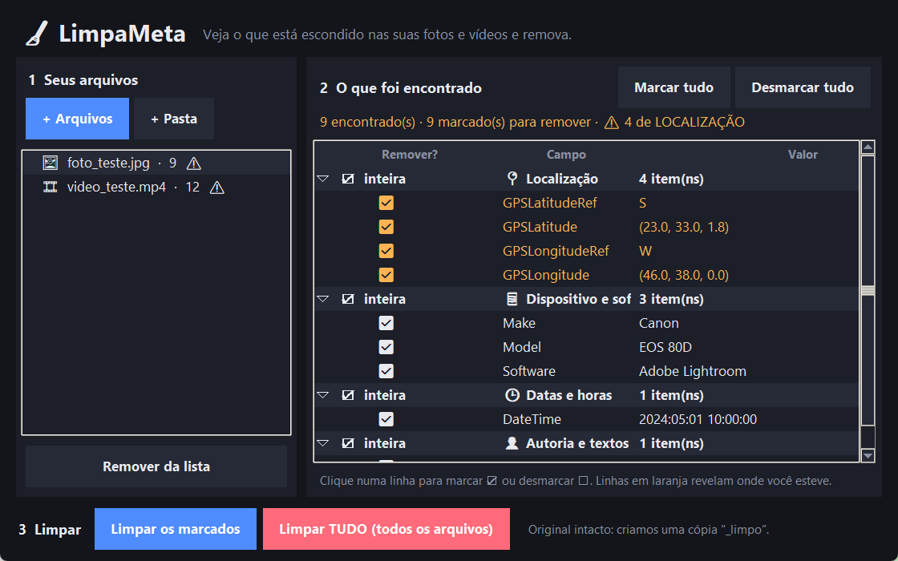
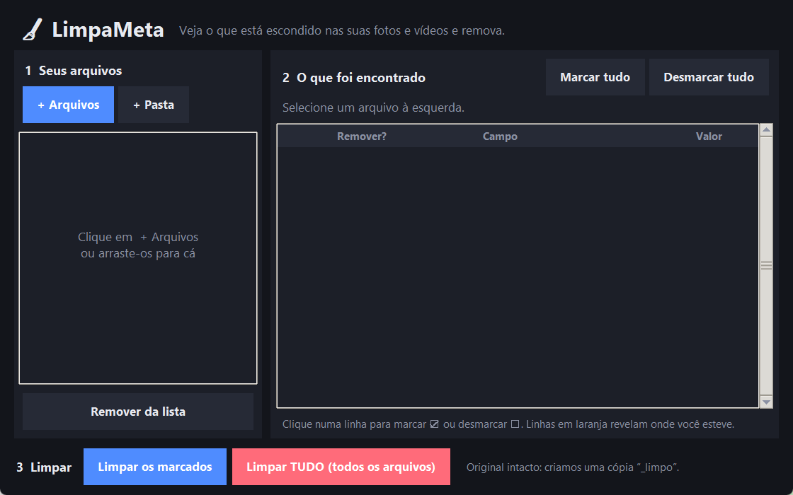
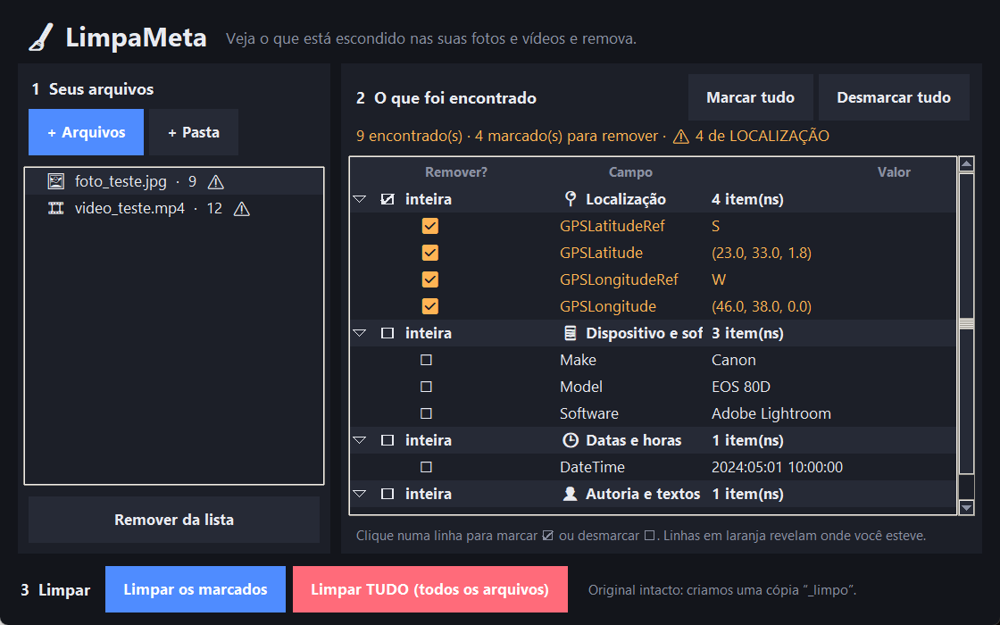
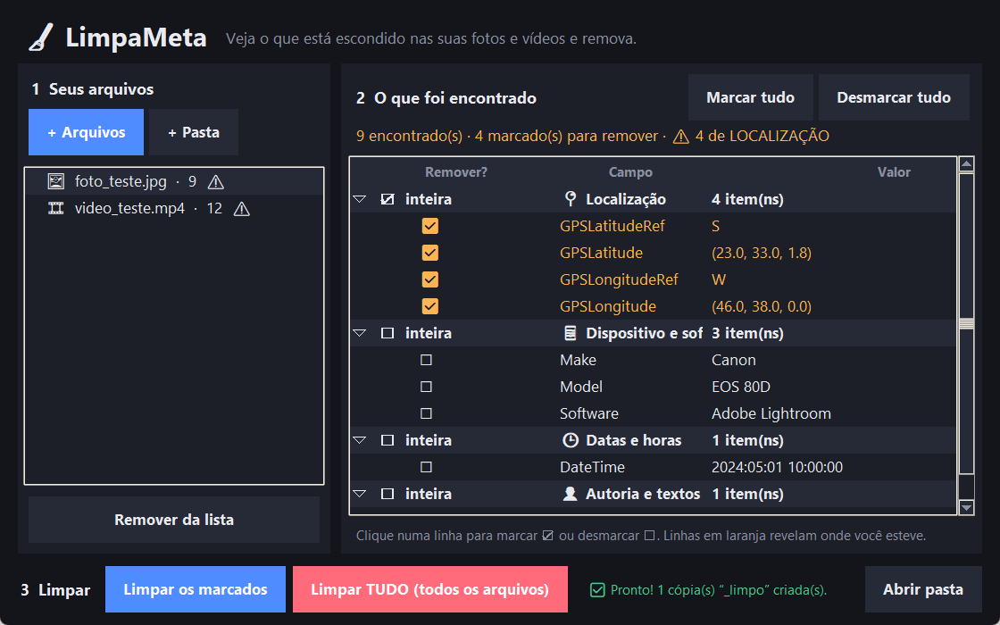

# 🧹 LimpaMeta

**Veja o que está escondido nas suas fotos e vídeos — e remova.**

Toda foto e todo vídeo carrega *metadados* invisíveis: onde você estava (GPS), qual celular/câmera usou, data e hora exatas, nome do autor, programa de edição e mais. Ao compartilhar um arquivo, você pode estar entregando tudo isso sem saber.

O **LimpaMeta** é um app de desktop para Windows que **mostra todos esses dados**, deixa você **escolher o que apagar** (ou apagar tudo) e **cria uma cópia limpa** do arquivo. O original nunca é alterado.



## ✨ O que ele faz

- 🔍 **Identifica** os metadados de fotos (EXIF, GPS, XMP, textos, perfil de cor) e vídeos (tags do arquivo e das trilhas, capas embutidas, capítulos).
- 🗂️ **Organiza por categoria**: 📍 Localização · 📱 Dispositivo e software · 🕒 Datas e horas · 👤 Autoria e textos · 🎨 Perfil de cor · ⚙️ Técnico.
- ⚠️ **Avisa** quando o arquivo revela localização (linhas em laranja).
- ☑️ **Remoção seletiva**: marque só o que quer apagar, ou limpe tudo de uma vez.
- 📦 **Vários arquivos** de uma vez, inclusive pastas inteiras, com arrastar e soltar.
- 🛡️ **Seguro**: grava `nome_limpo.ext` ao lado do original, sem tocar nele.
- ⚡ **Vídeos sem recodificar**: a limpeza copia o vídeo como está, então é rápida e sem perda de qualidade.
- 🖼️ **JPG sem perder qualidade extra**: é regravado preservando a qualidade original.

## 📋 Formatos suportados

| Tipo | Formatos |
|---|---|
| Fotos | JPG/JPEG, PNG, WebP, TIFF (via Pillow); HEIC, BMP, GIF, AVIF (via ffmpeg) |
| Vídeos | MP4, MOV, MKV, AVI, M4V, WebM, 3GP, MTS, WMV, FLV |

## 🚀 Instalação (Windows)

**Pré-requisitos**

- [Python 3.10+](https://www.python.org/downloads/)
- [ffmpeg](https://ffmpeg.org/) para vídeos: `winget install Gyan.FFmpeg`

**Instalar**

```powershell
git clone https://github.com/igorcacerez/limpameta.git
cd limpameta
powershell -ExecutionPolicy Bypass -File install.ps1
```

O script instala as dependências (Pillow e tkinterdnd2), copia o app para `%LOCALAPPDATA%\LimpaMeta` e cria atalhos na **Área de Trabalho** e no **Menu Iniciar**.

Prefere rodar sem instalar? `pip install -r requirements.txt` e depois `python limpameta.pyw`.

## 📖 Como usar

### 1. Adicione seus arquivos

Clique em **+ Arquivos** ou **+ Pasta**, ou arraste fotos e vídeos para a janela. Um ⚠ ao lado do nome indica que há dados de localização.



### 2. Veja o que foi encontrado

Clique em um arquivo da lista. Os metadados aparecem agrupados por categoria, e tudo que revela **onde você esteve** fica em laranja.


Vídeos funcionam do mesmo jeito (título, local, data de criação, encoder…):


### 3. Escolha o que remover

Clique numa linha para marcar ☑ ou desmarcar ☐. Clicar no título de um grupo marca/desmarca o grupo inteiro. **Marcar tudo** e **Desmarcar tudo** ficam no topo. Por padrão tudo vem marcado.

No exemplo, só a localização está marcada; modelo da câmera e datas serão mantidos:



### 4. Limpe

- **Limpar os marcados**: apaga só os campos marcados do arquivo atual.
- **Limpar TUDO (todos os arquivos)**: remove todos os metadados de todos os arquivos da lista.

Quando termina, aparece a confirmação em verde e o botão **Abrir pasta**. A cópia é salva como `nome_limpo.ext` (ou `nome_limpo2.ext` se já existir).



## ⚙️ Como funciona por dentro

- **Fotos**: o [Pillow](https://python-pillow.org/) lê e reescreve o EXIF (incluindo os blocos de GPS e Interop), XMP, textos e perfil de cor.
- **Vídeos**: o `ffprobe` lista as tags e o `ffmpeg` gera a cópia com `-map_metadata -1 -c copy` (limpeza total) ou zerando só as tags escolhidas.
- **Interface**: Tkinter com tema escuro; `tkinterdnd2` para arrastar e soltar.
- Arquivo único de ~500 linhas: [`limpameta.pyw`](limpameta.pyw).

## ⚠️ Limitações

- Alguns campos puramente técnicos de vídeos MP4 (como `major_brand` e `handler_name`) são recriados pelo próprio formato e não identificam você.
- Se um arquivo traz identificação *dentro da imagem ou do áudio* (rostos, vozes, marcas d'água), o LimpaMeta não remove: ele trata apenas metadados.
- Testado no Windows 11. Em outros sistemas pode funcionar, mas o instalador é só para Windows.

## 📄 Licença

[MIT](LICENSE)
