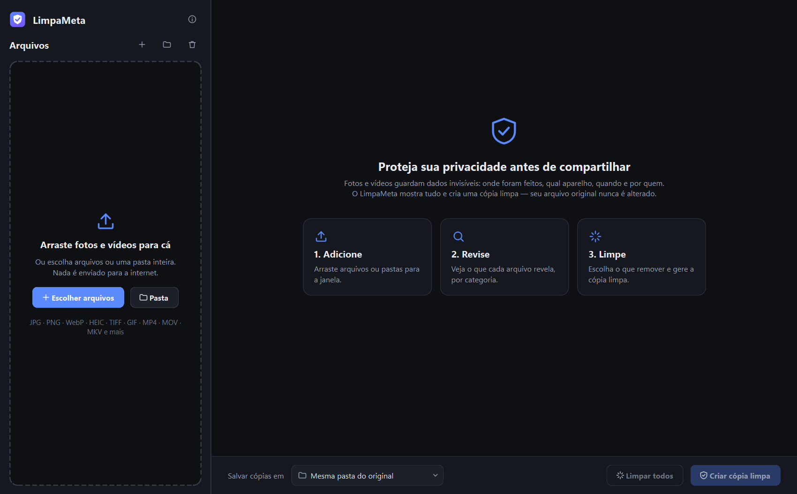
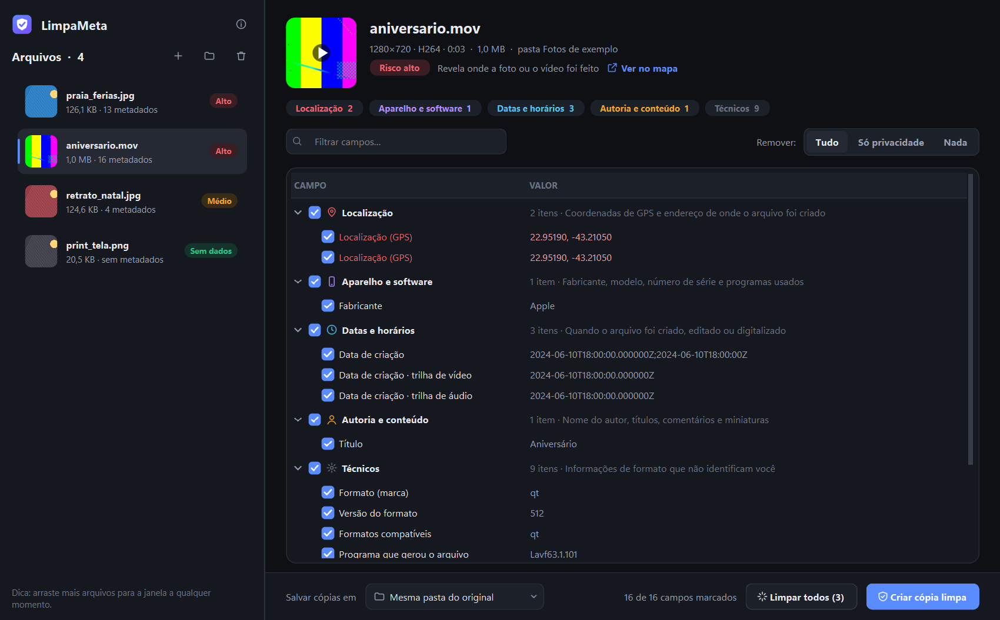
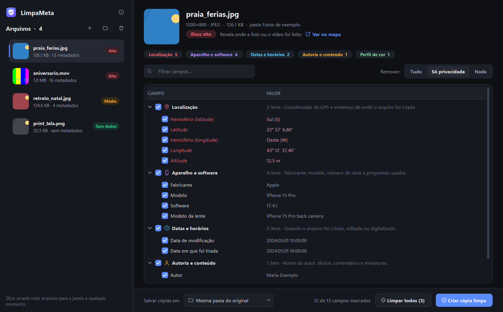

<div align="center">


# LimpaMeta

**Veja o que suas fotos e vídeos revelam sobre você e remova antes de compartilhar.**

[](https://github.com/igorcacerez/limpameta/releases/latest)


</div>


## Por que isso importa

Toda foto tirada no celular carrega dados invisíveis, os **metadados**. Muitas vezes eles incluem:

- 📍 as **coordenadas exatas de GPS** de onde a foto foi tirada (sua casa, a escola dos seus filhos);
- 📱 a **marca, o modelo e às vezes o número de série** do aparelho;
- 🕒 a **data e a hora** exatas;
- 👤 o **nome do autor**, comentários e até uma **miniatura da foto original** antes de você recortá-la.

Quando você envia o arquivo original por e-mail, Drive, WhatsApp como documento, marketplaces ou fóruns, esses dados vão junto.

O **LimpaMeta** mostra tudo isso de forma clara, deixa você escolher o que apagar e cria uma **cópia limpa**. O arquivo original nunca é alterado e nada sai do seu computador.

## Recursos

| | |
|---|---|
| 🔍 **Análise completa** | EXIF, GPS, XMP, IPTC, comentários, perfil de cor, miniaturas embutidas, dados extras após a imagem, tags de vídeo, telemetria (GoPro/iPhone), capas e capítulos. |
| 🗂️ **Organizado por risco** | Os campos são agrupados em Localização, Aparelho, Datas, Autoria, Perfil de cor e Técnicos. Cada arquivo recebe uma nota de risco: alto, médio ou baixo. |
| ☑️ **Você escolhe** | Remova tudo, só o que é pessoal (**Só privacidade**) ou marque campo a campo. |
| 🖼️ **Sem perda de qualidade** | JPG, PNG e WebP são limpos editando só os blocos de metadados. Os pixels ficam **idênticos** e os testes automáticos comprovam isso. |
| 🎞️ **Vídeos sem recodificar** | MP4, MOV, MKV e outros são remontados com `-c copy`. É rápido e não perde qualidade. |
| ✅ **Verificação automática** | Depois de limpar, o LimpaMeta relê a cópia e confirma que nenhum dado pessoal ficou para trás. |
| 📦 **Em lote** | Arraste pastas inteiras e limpe tudo de uma vez. |
| 🗺️ **Ver no mapa** | Veja exatamente qual local a foto estava revelando. |
| 🔒 **100% local** | Nenhum arquivo é enviado para a internet. |

## Instalação

1. Baixe o **`LimpaMeta-Setup-x.y.z.exe`** na página de [Releases](https://github.com/igorcacerez/limpameta/releases/latest).
2. Abra o instalador e avance as telas. Não precisa ser administrador.
3. Pronto: o LimpaMeta aparece no **Menu Iniciar**, na **Área de Trabalho** e no menu **Enviar para** do Explorador de Arquivos (clique com o botão direito numa foto, depois *Enviar para → LimpaMeta*).

> Prefere não instalar? Baixe o `LimpaMeta-x.y.z-portable.zip`, extraia e rode o `LimpaMeta.exe`.

**Vídeos** precisam do [FFmpeg](https://ffmpeg.org/), que é gratuito. Se ele não estiver instalado, o próprio LimpaMeta mostra um botão **Instalar FFmpeg**. Fotos funcionam sem ele.

> O Windows SmartScreen pode avisar que o app é de um "editor desconhecido", porque o instalador não tem assinatura digital paga. Clique em **Mais informações → Executar assim mesmo**. O código está todo aqui para quem quiser conferir ou compilar.

## Como usar

### 1. Adicione os arquivos

Arraste fotos, vídeos ou pastas inteiras para a janela, ou clique em **Escolher arquivos**.



### 2. Veja o que cada arquivo revela

À esquerda, cada arquivo mostra uma nota de risco: **Alto** (tem localização), **Médio** (aparelho, autor ou datas), **Baixo** (só dados técnicos) ou **Sem dados**.

Ao selecionar um arquivo, os metadados aparecem agrupados por categoria. A localização fica destacada em vermelho, e **Ver no mapa** mostra o ponto exato.


Vídeos funcionam do mesmo jeito. Os campos mostram de qual trilha vêm (vídeo ou áudio):



### 3. Escolha o que remover

- **Tudo**: remove todos os metadados (padrão).
- **Só privacidade**: remove localização, aparelho, datas e autoria, e mantém o perfil de cor e os dados técnicos.
- **Nada**: desmarca tudo, para você escolher campo a campo.

Clique em qualquer linha para marcar ou desmarcar. Clicar no título de um grupo marca o grupo inteiro. Use **Filtrar campos…** para achar algo específico.



### 4. Crie a cópia limpa

- **Criar cópia limpa** (ou `Ctrl+Enter`): limpa o arquivo selecionado.
- **Limpar todos**: limpa todos os arquivos da lista, cada um com as opções marcadas nele.

A cópia é salva como `nome_limpo.ext`, ao lado do original ou na pasta que você escolher em **Salvar cópias em**. Ao terminar, o LimpaMeta confirma o resultado e oferece **Mostrar na pasta**, **Abrir** e **Analisar cópia** (para você ver com seus próprios olhos que ela está limpa).


### Atalhos

| Tecla | Ação |
|---|---|
| `Ctrl+O` | Adicionar arquivos |
| `Ctrl+Enter` | Criar cópia limpa do arquivo selecionado |
| `Delete` | Remover o arquivo selecionado da lista |
| Botão direito | Copiar valor, mostrar na pasta, abrir |

## Formatos suportados

| Tipo | Formatos | Como é limpo |
|---|---|---|
| Fotos | **JPG, PNG, WebP** | Sem recompressão: remove ou reescreve só os blocos de metadados |
| Fotos | TIFF, GIF, BMP | Regravado sem perdas (formatos sem compressão com perda) |
| Fotos | HEIC, HEIF, AVIF | Regravado em qualidade alta (95). O app avisa quando isso acontece |
| Vídeos | MP4, MOV, M4V, MKV, WebM, AVI, 3GP, MTS, M2TS, WMV, FLV | Remontado pelo FFmpeg sem recodificar |

## Perguntas frequentes

**O LimpaMeta altera meu arquivo original?**
Não. Ele sempre cria uma cópia nova (`_limpo`). Se já existir uma, ele numera (`_limpo2`, `_limpo3`…).

**A foto perde qualidade?**
Em JPG, PNG e WebP, não: a imagem comprimida é copiada byte a byte. Só HEIC/AVIF são recomprimidos (em qualidade 95), porque não há como editar os metadados desses formatos sem regravar.

**Por que alguns campos "Técnicos" continuam no vídeo?**
Campos como `major_brand` e `handler_name` fazem parte da estrutura do formato MP4/MOV e são recriados em qualquer arquivo. Eles não identificam você. A verificação automática só considera localização, aparelho, datas e autoria.

**O que o LimpaMeta não remove?**
Ele trata **metadados**. Informações que estão *dentro* da imagem ou do som (rostos, placas, reflexos, vozes, marcas d'água) continuam lá.

**Onde ficam os registros de erro?**
Em `%LOCALAPPDATA%\LimpaMeta\logs`. Também dá para abrir pelo botão ⓘ → **Abrir registros**.

## Para desenvolvedores

Requisitos: Python 3.10+, e FFmpeg para os testes de vídeo.

```bash
git clone https://github.com/igorcacerez/limpameta.git
cd limpameta
pip install -r requirements-dev.txt
python limpameta_app.py   # roda o app
pytest                    # roda os testes
```

Para gerar o instalador (precisa do [Inno Setup 6](https://jrsoftware.org/isinfo.php): `winget install JRSoftware.InnoSetup`):

```powershell
powershell -ExecutionPolicy Bypass -File build.ps1
```

O build roda os testes, empacota com PyInstaller, abre e fecha o `.exe` para validar, e gera `dist\LimpaMeta-Setup-x.y.z.exe` e o `.zip` portátil.

### Estrutura

```
src/limpameta/
  core.py      leitura e limpeza de metadados (sem interface; testável)
  ui.py        interface em PySide6 (Qt)
  assets/      ícone
tests/         testes automáticos (JPG, PNG, WebP, HEIC, GIF, MP4, MOV, MKV)
installer/     script do Inno Setup
tools/         gerador do ícone e das capturas de tela do README
build.ps1      build completo: testes, .exe, instalador e zip
```

### Como a limpeza funciona

- **JPEG**: o arquivo é dividido em segmentos. APP1 (EXIF/XMP), APP13 (IPTC), APP2 (ICC/MPF), COM e outros APPn são removidos ou reescritos. O EXIF seletivo é regravado pelo Pillow. Os dados comprimidos da imagem (SOS→EOI) são copiados intactos, e dados extras depois do EOI (mapas de profundidade, HDR) são removíveis.
- **PNG**: os chunks `tEXt`, `zTXt`, `iTXt`, `eXIf`, `tIME` e `iCCP` são removidos ou reescritos, com o CRC recalculado.
- **WebP**: os chunks RIFF `EXIF`, `XMP ` e `ICCP` são removidos, e as flags do `VP8X` e o tamanho do RIFF são corrigidos.
- **Vídeo**: `ffmpeg -map 0 -c copy` com `-map_metadata -1` (ou com tags específicas zeradas). Trilhas de telemetria e capas embutidas podem ser descartadas.

## Licença

[MIT](LICENSE). Use, modifique e distribua à vontade.
